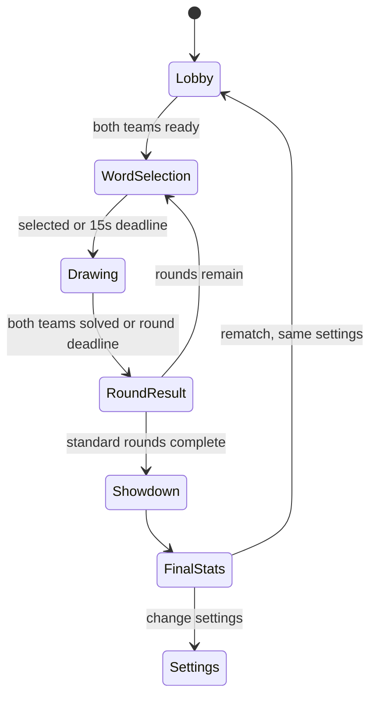

# Dual Draw product specification

Status: **working product contract**. Items labelled “hypothesis” are proposed
defaults, not settled user decisions.

## Product promise

Each team receives its own secret prompt. One active drawer on each team draws
simultaneously while their own teammates guess. The game rewards fast guesses,
hard prompts, and comebacks without making the winning team feel cheated.

The experience must remain usable on a phone: drawing stays visible while a
guesser types, pressing Enter does not scroll the canvas away, and returning
from another app resumes the live match.

## Terms

- **Room:** a resumable game session entered with a short code.
- **Team:** Team A or Team B.
- **Active drawer:** the one player currently drawing for a team.
- **Guessers:** the active drawer's teammates for that round.
- **Word draft:** the 15-second period in which each active drawer chooses their
  team's prompt independently.
- **Round:** two concurrent word drafts, drawing/guessing, then scoring.
- **Showdown:** a redraw relay through each team's shuffled prior word set.

## Core loop



The room server, not a browser, owns every transition and deadline.

## Proposed default settings

| Setting                   |                                                Default | Allowed initially                          |
| ------------------------- | -----------------------------------------------------: | ------------------------------------------ |
| Players                   |                                              4 minimum | 2–8 per team, 16 total                     |
| Standard rounds           |                                                      6 | 4–16, even numbers                         |
| Word-selection time       |                                             15 seconds | Fixed for the first version                |
| Drawing time              |                                             90 seconds | 45, 60, 75, or 90 seconds                  |
| Round results             |                                              8 seconds | Fixed for the first version                |
| Word choices              |                                                      3 | 2–7                                        |
| Word replacements         |                                           1 per drawer | 0–5; shared across replacement reasons     |
| Opponent draft visibility |                                           Actions only | Options + actions, actions only, or hidden |
| Word length               | Hidden; team-majority reveal after 30s costs 10 points | Shown, hidden, or reveal disabled          |
| Prompt difficulty         |                                                  Mixed | Easy, mixed, or hard-biased                |
| Colors                    |                   Accessible palette plus custom color | Host may restrict for modes later          |
| Stroke sizes              |                                              4 presets | Thin through extra thick                   |
| Showdown                  |                                        On; 120 seconds | On or off                                  |

Room settings are visible to everyone before ready-up. The host proposes
changes; the game starts only when every connected player marks ready.

## Teams, rotation, and word choice

Player names must show something: invisible characters (zero-width spaces,
right-to-left overrides and similar) are stripped, a name left blank becomes
"Player" in a room, and an account display name that is blank this way is
refused with "Display names need at least one visible character."

Drawer rotation is independent and round-robin within each team, skipping
players only after their reconnect grace expires. The turn always passes to
the next teammate (in join order) after whoever drew last, so a teammate who
is away, joins late, or leaves never makes someone draw twice in a row while
another teammate is waiting. Each team has one active drawer and its own
draft, prompt, canvas, guesses, and round score.

During the 15-second draft, each active drawer sees their candidate words and
difficulty labels and may select one or replace it for either of two explicit
reasons: **seen before** or **I do not know this word's definition**. Both
reasons consume the same configured replacement allowance; unfamiliarity does
not create an unlimited reroll path. At the deadline, the server randomly
selects one of that drawer's remaining candidates. The two drafts do not block
each other. A drawer whose card was picked this way is told so, never left
guessing why the screen changed: a one-time toast on the switch to drawing
("Time's up! We picked paper shredder (Hard +40) for you.") and a short line
in their word banner for the rest of the round ("Time ran out, so we picked
this card for you."). Only the drawer learns this; guessers and the other
team see nothing about it.

Replacement actions retain their reason, actor, and server timestamp for room
history and moderation. Opponents may observe the action only when the room's
draft-visibility setting permits it. A word's stored definition is editorial
metadata for the catalog and is never sent to guessers with a live answer.

Each final answer is hidden from every guesser and from the other drawer; it
is delivered only to the drawer who chose it. What the **opposing team** sees
of a draft is an explicit room setting, changeable in the lobby:

- **Actions only (default):** the opposing team sees that the other drawer
  swapped a card and why ("seen it" / "don't know it"), never the words.
- **Options + actions:** the opposing team also sees the other drawer's
  cards (terms and difficulty) while the draft is open, but never the pick.
- **Hidden:** opponents see neither options nor draft actions.

Guessers' own-word clues (the difficulty chip with its bonus, the category
hint, and the letter blanks) each tell a draft's cards apart: a balanced
draft has one card per difficulty, cards prefer different packs, and terms
differ in length. So with **options + actions**, a seat on the other team (a
friend, or the same person in a second tab) plus any one clue would name the
exact answer. Therefore:

- The default is **actions only**, so guessers keep every clue. (The first
  version defaulted to options + actions; see ADR 0008.)
- When a host chooses **options + actions**, guessers get no difficulty, no
  category, and no letter blanks for their own word (the word-length setting
  acts as "never shown" and there is no reveal vote). The lobby says so next
  to the Clues settings; the difficulty, bonus, and category appear in the
  round results as usual. The drawer still sees everything about their word.
- Someone who joins after a draft's cards were dealt never sees that draft's
  cards, only later ones.

Options + actions remains a playful, trust-based mode: the opposing team
could still relay the shortlist of cards to the owning team's guessers. A
future ranked/public mode should use hidden.

A same-prompt race can be added later as a separate setting. It is not the
default because independent choices and difficulty bonuses are part of the
current competitive design.

The server avoids recently used room words and records seen reports separately
from correctness. A report is a personalization signal, not proof that a word
must be deleted globally.

Personal memory follows a player between rooms. An account's history lives on
the server; a guest's browser keeps the same two kinds of memory locally and
sends them when joining a room:

- words the guest drew (still the drawer when the round ended) or reported
  "Seen it" on as drawer. Like an account's, these are never dealt to them as
  drawer again while the pool has a fresh word for the slot;
- every other word they met: their team's word as a guesser, the other draft
  cards they were dealt, "Don't know it" swaps, and the other team's word,
  because round results reveal both words to everyone. These are dealt less
  often.

The browser keeps the newest 300 of each. A drawer whose turn a teammate
took over did not draw the word, so it is only "met" for them, as for an
account.

A seat in a room follows the browser's quick-account sign-in. Signing in
(in any tab, or with "Create a quick account" on the final screen) links the
open seat at once and credits the match so far; signing out (in any tab, or
when the account's session turns out to be expired) unlinks it, so nothing
more from that room is recorded to the account. A toast says which happened
("Saved to @name: this match is in your stats." / "Signed out: this seat no
longer saves stats."), and the lobby's "Stats saved" tag follows.

A match is saved to at most one account, and only for a seat that played
some of it. The final screen and the toast say only what the room actually
saved, never just "you are signed in":

- Signed in and this account has the match: "Stats saved to @name · this
  match is in your history." with a "See your stats" link (opening /me in a
  new tab, so the seat stays for a rematch).
- A guest who played and has nothing saved: "Create a quick account to keep
  your stats". Signing up (or logging in) there saves this match.
- A seat that did not play (it joined after the last round, or was away for
  all of it) is not promised this match: "Save your next matches" for a
  guest, "Signed in as @name · You didn't play in this match…" once signed
  in, and the toast says "your next matches here will be saved." The winner
  banner says "You didn't play this one. You're in for the rematch." instead
  of cheering the team.
- A match already saved to another account stays there: after signing out,
  the screen says "This match is saved to @first" and offers to log in for
  the next matches; signing in to a different account says "This match is
  saved to @first · You're signed in as @second now…", and the toast adds
  "This one stays saved to @first."
- A seat that signed out before the match ended and signs back in on the
  final screen gets the match result then (once), without its words twice.

/me shows every lifetime total the account keeps: matches and win rate,
points won (team points from the player's own correct guesses), drawings
solved and how many different words they have drawn, average solve time as
drawer, correct guesses, accuracy and average time to correct (both timed
from the start of drawing), fastest correct, hard words, and Showdown cards.
In Recent words a Showdown relay card carries a "Showdown" tag, so it is not
mistaken for the round in which the same word was first drawn. A signed-in
player who leaves a match and rejoins it by code gets one match in their
stats, with what they did before and after rejoining added together.

### Custom words and repeats

A host can tag a custom word with the difficulty it should score as by adding
`|easy`, `|medium` or `|hard` after it (`paper shredder|hard`, spaces and
capitals around the tag are fine). Tagged words are dealt like curated ones,
so a tagged list gives balanced easy/medium/hard drafts with the usual
bonuses. An untagged word has no rating: it scores like a medium word (+20),
and the drawer's card, word banner and the round results label it "Custom ·
+20" instead of inventing a difficulty. Guessers' stake chip still reads
"Medium +20", because "Custom" would tell them it is one of the host's words
even with the category hint off. An entry whose tag is not one of the three
is skipped (the lobby says how many), so a typo never becomes part of an
answer. Custom words have no definition, so their cards offer no "What's
this?" and "Don't know it" swaps straight away; the draft's help line says
these are the host's own words.

The host's custom words are answers, so only the current host ever receives
the list (it passes to the next host if the host leaves). Everyone else sees
how many custom words there are and whether only they are used. Words drawn
from the list are revealed one at a time in round results like any other
word; the rest of the list is never revealed, because a rematch reuses it.

A word drawn in a room does not come back in that room (across rounds and
rematches) while any never-drawn word is left. Only when the pool runs out
does a draft deal a drawn word, and then the least recently drawn one. Such a
card is marked "Drawn here before" for the drawer, and practice bots and the
draft deadline's automatic pick choose a never-drawn card whenever the hand
has one. The lobby counts the room's never-drawn words and, when they cannot
cover every card the configured match could deal (two drafts plus every swap
per round, two words drawn per round), warns everyone from which round cards
may repeat. The host can still start: a short family list is a legitimate
choice, as long as nobody is told words never repeat. A swap never hands a
drawer a card from the other team's hand (it could be their answer): on a
list so short that nothing else is left, the swap is refused with "There are
no other words left to swap in."

## Drawing and guessing

Each team has its own canvas. The initial tool set is:

- freehand strokes with several sizes and an accessible color palette;
- tap-to-dot marks whose diameter follows the selected stroke size, for details
  such as strawberry seeds or eyes;
- object eraser that removes an entire stroke selected by hit testing;
- precise eraser as an optional later tool, not the only eraser;
- undo and redo for the active drawer's semantic actions;
- reversible clear-canvas action; and
- pointer support for touch, pen, and mouse.

The drawer sees local ink immediately. Guessers receive ordered vector updates
and can keep submitting guesses until their team solves the word or time ends.
A short tap commits one round, single-point stroke; beginning a drag must not
add a second dot beneath the line.
Guess matching is server-side, case-insensitive, whitespace-normalized, and
accent-tolerant. Fuzzy spelling tolerance is a later, bounded setting because
overly broad matching can reveal answers or accept wrong words.
Near-miss feedback ("So close", "Part right") is private to the guesser and
their team's drawer (who can steer the drawing). Other teammates see those
guesses in the team feed as plain wrong guesses, so nobody can copy a near
miss into a solve.

The opponent view is deliberately unhelpful but entertaining: a low-frequency,
coarse grid derived by the server, followed by visual blur/pixelation. The raw
opponent strokes are never sent to the browser during the round.

### Stable mobile layout

The canvas is the stable primary pane. Guess history scrolls inside its own
region, and the guess composer is a keyboard-aware overlay or dock—not content
inserted above the canvas. Focusing the input uses `preventScroll`; submitting
the form keeps focus and does not navigate, reset the page, or change document
scroll position. Layout follows the visual viewport when the on-screen keyboard
opens, with safe-area insets respected.

Acceptance is behavioral: on supported iPhone and Android sizes, a player can
focus, type, submit a wrong guess, and type again while the same meaningful
portion of the drawing remains visible.

Fast guessing never loses a guess. The input clears as soon as a guess is
sent, so the next one can be typed and sent at once; the game queues them and
delivers each in order (the room takes one guess per player every 400 ms). A
guess that still fails to send comes back into an empty input, selected so
Enter resends it and typing replaces it; if the player is already typing the
next guess, the status line names the one that did not send.

Phone choices that follow from this (portrait and landscape):

- **The drawing stays the main element while typing.** Touch phones default
  to the in-app compact keyboard. While it (or the phone's own keyboard) is
  up, the clue collapses to one line (letter blanks, category, difficulty
  with its bonus, and the reveal vote), the team feed and opponent tile step
  aside, and the guess status line carries the newest teammate guess and the
  other team's progress. On a typical 390 x 664 phone the drawing keeps its
  full width with the compact keys up, and stays about two-thirds of the
  width with the phone keyboard open. A keyboard button next to the input
  switches between the compact and the phone keyboard; a "hide keyboard" key
  tucks the compact keys away to see the drawing larger, and tapping the
  input brings them back. Nothing covers the keys: the `next dev` route
  indicator, which sat on Backspace when the owner played from a phone on
  `pnpm dev`, is turned off.
- **No zoom on the game surface.** Pinch and double-tap never zoom any play
  screen (join, lobby, draft, drawing, results). Browser and accessibility
  zoom are still allowed for players who need them, and then the layout
  keeps its size rather than squeezing into the zoomed area.
- **Every drawing tool is on screen.** Phones show pen, eraser, size, undo,
  redo, clear, and all 12 colors without a sideways scroll: two rows under
  the canvas in portrait, a narrow tool panel beside it in landscape. Nothing
  floats over the drawer's paper, so every corner can be drawn on.
- **The whole draft fits.** On phones the three cards are compact rows with
  the difficulty and bonus side by side, so they compare at a glance during
  the 15-second pick; tapping a row picks it and its `?` shows the meaning
  and the "seen it" / "don't know it" swaps. The top bar's countdown is the
  only timer.
- **Big enough to tap.** Controls are at least 40 px in their smaller
  dimension (most are 44 px), inline links included ("Log in to save stats",
  the account page's "Log in" / "Create an account" switch). Compact
  keyboard keys are 40 px tall and as wide as ten keys to a row allow, like
  the phone's own keyboard: about 35 px on a 390 px portrait phone. On
  landscape phones the guess sidebar takes the width the drawing does not
  need (the drawing is limited by height there), so the keys are 37 px wide
  from about 740 px and 30 px on a 667 x 375 iPhone SE, and the drawing
  keeps its size.
- **Readable under pressure.** In its last 10 seconds the countdown turns
  coral with dark text (about 6.4:1; white on coral was 2.8:1) and a ring
  pulses out from it once a second. It never fades, and with reduced motion
  it stays still. Other small text on coral (error toasts, a guess that did
  not send, form errors, "Leave room") is dark for the same reason.

## Word-length reveal vote

Default: hide length. After 30 seconds, a team's guessers may vote to reveal
their own word length. More than half of that team's eligible guessers must
approve; drawers do not vote, ties fail, and each guesser gets one vote. A
recently disconnected guesser remains in the electorate until the reconnect
grace expires, preventing a momentary Safari suspension from changing quorum.
The votes already cast count against whoever is eligible right now: if a
teammate leaves, drops past the grace, or takes over the drawing, and the yes
votes already cast are now a majority, the reveal happens at that moment
without anyone voting again.

A successful reveal displays blanks only to that team and deducts 10 points if
the team later solves the prompt. The other team's hint state and score are
unaffected. The 30-second delay is a **playtest hypothesis**; team-local majority
and the 10-point cost are current defaults.

## Scoring

Only a correct guess scores. Each team is scored independently from the server
receipt time of its first correct guess:

```text
secondsRemaining = clamp((deadlineAt - receivedAt) / 1000, 0, roundSeconds)
speedPoints      = round(50 + 50 * secondsRemaining / roundSeconds)
difficultyBonus  = easy: 0, medium: 20, hard: 40
hintCost         = revealedWordLength ? 10 : 0
roundPoints      = speedPoints + difficultyBonus - hintCost
```

An unhinted correct answer is bounded from 50 to 140 points; an easy hinted
answer can be as low as 40. The continuous time term avoids a large “first
place” step, so ordinary network jitter has limited impact. The active drawer
receives a successful-drawing credit and difficulty credit in personal stats;
team score remains the competitive source of truth.

The first team to solve does **not** end the round. Its first accepted correct
guess locks that team's points and ignores duplicate correct submissions for
scoring, while the other team keeps drawing and guessing against the original
server deadline. The round ends early only after both teams solve; otherwise it
ends at the deadline. This preserves a real chance to redeem diminishing speed
points instead of turning the first solve into a winner-take-all cutoff.

## Word catalog and collections

The canonical **Master list** is the derived set of every active, eligible word
known to the game. An administrator may create custom collections—such as
“Animals,” “Movie night,” or “Orien's favorites”—whose memberships reference
stable word IDs rather than copying word text.

Each catalog word records its display term, normalized term, locale,
definition, difficulty, tags, source/provenance, active status, and version.
The same canonical term cannot be duplicated within a locale. Removing a word
from a custom collection does not remove it from the Master list; deactivating
the word removes it from every playable selection while preserving its stable
identity and history. Bulk imports validate completely before changing the
catalog so one bad row cannot leave a half-imported word bank.

### Shutdown bonus

When the team that was trailing before the round wins that round and breaks an
opponent streak of at least two wins, add:

```text
shutdown = min(30, 10 * (opponentWinStreak - 1))
```

The bonus is 10, 20, or at most 30 points. A tied or leading team cannot collect
it, and it resets when the streak is broken. This is deliberately meaningful
without tracking or refunding the point differential. The constants remain a
playtest target, but the implementation and tests use this exact formula.

## Disconnect behavior

Disconnecting does not remove a player from the room. Their role, team, score,
and drawing remain. A returning browser resumes the current phase, even if the
round advanced while it was away.

An active drawer gets a 10-second reconnect grace (a locked phone or a quick
app switch). Back within it, they simply carry on. If they are still away
when it runs out and a teammate is connected, the next connected teammate in
rotation takes over the same turn: the same cards and remaining swaps during
the draft, or the same word and canvas while drawing or on a Showdown card,
for the remaining time. The returning player sits out the rest of that turn
(below) and plays on as usual. The team never loses a whole round (or the rest of the Showdown) to
one dropped phone, and a single disconnect never pauses either team. If
nobody on the team is connected the turn waits, and the first teammate back
takes it. The 10 seconds remain a playtest target.

An active drawer who explicitly leaves during the word draft, the drawing, or
a Showdown card hands the turn over the same way, at once (to a teammate
within their own grace if there is one). The team keeps playing instead of
waiting out the clock; the other team is unaffected.

Either way the new drawer is told why their screen switched from guessing to
drawing, e.g. "Max left the room. You're picking your team's word now." or
"Max lost connection. You're drawing now: same word, same canvas."

A drawer whose turn was taken over has already seen its cards (and maybe the
word), so when they come back they watch the rest of that turn instead of
guessing it, and guess as usual from the next turn. Their guess box says so
("You saw this word as the drawer. Guess next round!", or "…Guess the next
one!" for a Showdown card) while their teammates keep guessing. For the same reason a
takeover only happens when someone else on the team could still guess: in a
pair (or one player with one practice bot) the turn waits for the drawer.

Nobody is credited with play they were not there for. A word auto-picked for
a drawer who was away the whole time is not "drew" (and never joins their
never-again list), a guesser who was away is not "missed", and a player who
was away for the entire match gets no match result. If nobody human is
connected for a full minute (or everyone has left), the match is abandoned:
the room goes back to the lobby and the match is not recorded, so practice
bots never play out a match, and hand someone a loss, after they closed the
tab. A minute is meant to survive a locked phone or a brief server restart.

## Fair-use limits

The servers protect themselves from floods and scripts. The limits are set
far above real play, so nobody in an actual game (or testing locally with
many tabs) should ever meet one:

- **Actions in a room.** Each player can send 20 actions back to back, then 5
  a second (people click a few times a second at most, and guesses are
  already paced to about 2 a second). Drawing has its own, larger budget:
  240 updates back to back, then 30 a second. A fast scribbler sends about
  15 a second, and the burst covers the backlog a phone sends after a
  reconnect. An action over the limit is refused with "Too many actions at
  once. Wait a moment and try again." and nothing happens, so it can simply
  be sent again. Re-sending an action the room already applied (as a
  reconnect does) is always free. The budget belongs to the player, not the
  connection, so reconnecting does not reset it.
- **Joining.** A connection has 30 seconds to join or rejoin the room;
  otherwise the server closes it and the browser quietly reconnects. Someone
  can keep the join form open as long as they like, and joining stays
  instant.
- **Idle rooms.** A room is deleted after 6 hours without activity once no
  player is connected. A tab still on the join form does not keep it alive;
  it is told the room no longer exists.
- **Per network.** Creating rooms (30 at once, then one every 2 seconds),
  looking up room codes or opening room connections (120, then 2 a second),
  creating accounts (20, then one every 30 seconds), and signing in (30, then
  one every 5 seconds) are limited per internet address. The browser on the
  computer running the local dev server is never limited; phones on the
  same Wi-Fi are, but far above what a party needs. These limits live in
  server memory as a first line of defence; a public deployment should add a
  Cloudflare rate-limiting rule as well.

## Surrender and rematch

Surrender is available only during the between-round results phase, after three
completed rounds, and only to a team trailing by at least 100 points. It requires
two thirds of that team's eligible voters. A disconnected player remains in the
electorate during reconnect grace and is excluded only after grace expires. As
with the hint vote, yes votes already cast count against the current
electorate, so a teammate leaving or dropping past the grace can complete a
surrender without a new vote. A successful surrender ends the match and
records the opponent as winner without inventing extra points.

The trailing team must get a fair chance to vote, so:

- The "Call it here?" prompt is the first thing on that team's results
  screen, above both drawings, so nobody has to scroll to find it.
- The first yes vote of a results screen leaves at least 15 seconds on the
  results clock (extended once; changing or re-casting votes never extends
  it again), so teammates can answer.
- While the vote is still open (someone eligible to vote has not voted and
  enough yes votes are still possible), the host cannot skip ahead; the
  bottom bar says which team can still vote. The results continue when the
  clock runs out, or as soon as the vote can no longer pass (for example,
  enough of the team voted "No, keep playing").

The postgame screen offers:

1. **Run it back:** preserve roster, teams, and settings; reset scores, rotation,
   seen-word session state, and canvases.
2. **Change settings:** preserve the room and roster, reopen settings, clear all
   ready states, then reset the match.

No one should have to re-enter a game code for either path.

## Showdown and final stats

Showdown is a 120-second redraw relay after the standard rounds. Each team's
previously selected word set is shuffled independently. The current relay
drawer redraws the active card from scratch; a correct team guess advances
immediately to the next card and next round-robin drawer. The schedule is
balanced so teammates' draw counts differ by at most one turn.

Each cleared card adds 10 points. The first team to clear its entire set earns a
20-point finish bonus. Difficulty, normal-round speed scoring, word-length
hints, and shutdown bonuses do not apply. If time expires, the team with more
cleared cards earns only the points for those cards—there is no invented
completion bonus.

Old images are not Showdown clues. They may appear afterward in the match recap,
where players can compare the original and relay drawings.

The final page should make different kinds of contribution visible:

- team score, rounds won, comeback points, and largest lead (the biggest
  margin a team held after any round or showdown card);
- successful drawings, median team solve time while drawing, and hard-word
  successes;
- correct guesses, guess accuracy, median time to correct, and close attempts;
- disconnect/reconnect count as a quality diagnostic, not a public shame stat;
- per-word and per-round timeline for the room's recap.

Players who left mid-match keep their row in the per-player table, tagged
"Left", so a player who rejoined by code under the same name (a new seat,
with its own row) can be told apart from the seat they left. A seat that left
without drawing, guessing, or scoring anything has no row.

Avoid a single “best player” number until evidence shows it cannot reward spam,
easy-word selection, or other behavior that makes the game worse.

## Practice bots

Practice bots let one person play a whole match. They should give a fair
contest, not a reading test or a walkover:

- **A bot drawer sets a puzzle, it never writes the answer.** It draws one
  blank per letter (all the same width, so they give nothing away beyond the
  length and word breaks), then reveals letters one at a time over the round,
  at most 60 % of them and never the whole word. The human guesses from the
  blanks, the revealed letters, and the category, with the usual forgiving
  matching.
- **Both teams' bots play by the same clock.** A bot guesser gets the word at
  a random point of the round that depends only on its difficulty (easy
  sooner, hard later) and sometimes not at all (more often for hard words),
  whether a bot or a human is drawing. So the opposing bot pair no longer
  solves every round in seconds, and the difficulty bonus is a real gamble.
- **A bot teammate only "recognizes" a real attempt.** It needs a few strokes
  and some ink (more for harder words) before it answers a human's drawing;
  a few slashes are not a lighthouse. Bots cannot see the picture, so this is
  deliberately loose.

In simulated solo matches (the human draws properly and solves the bot's
puzzle at its 2nd, 3rd, or 5th letter) the human's team wins about 13, 11,
and 4 of 16: skill decides, and the solo player can win. The constants are
playtest targets.

## Open product questions

1. Should a later game mode let both teams draw the same shared prompt?
2. Should Showdown eventually allow a timed pass that moves a stuck card to the
   back of the team's queue?
3. Resolved: a drawer disconnected past the 10-second grace is replaced by
   the next connected teammate for the rest of the turn (see Disconnect
   behavior). A host setting to pause instead can be revisited after mobile
   playtests.
4. Are rooms private-by-code only, or will public matchmaking and moderation be
   required? This materially changes safety and account architecture.
5. How long should drawings, transcripts, and personal statistics be retained,
   especially if minors may use the product?
